# 🚀 Awesome Embedded UI Component Frameworks

  

  
  
  
  
  
  
  

---

## ⚡ Top Embedded UI Component Framework Ecosystem

> **Curated List of SaaS Products & Open-Source GitHub Projects**  
> *Focused on Embeddable UI, Low-Code Integration, Modular Frontends & Developer SDKs*  
> **Last updated: March 2026**

This repository is an SEO-optimized, community-curated directory tracking premier **SaaS platforms** and **battle-tested open-source repositories** for **Embedded UI Component Frameworks**. These state-of-the-art tools empower developers to embed interactive user interfaces, headless admin panels, visual page builders, dynamic forms, and real-time business intelligence dashboards seamlessly into their web applications without building from scratch.

### 🌟 Key Categories & Highlights
- **Enterprise SaaS Embed Leaders**: Power BI Embedded, Looker Embed SDK, Salesforce Lightning Out, ThoughtSpot Everywhere, Retool Embed, SingleStore Embed, Sisense Compose SDK, Superblocks Embed, Appsmith Embed, and DronaHQ Embed.
- **Battle-Tested Open-Source Projects**: Self-hosted low-code platforms, headless visual CMS engines, data apps, dynamic JSON form generators, and embeddable UI SDKs.

Contributions are warmly welcome! Feel free to open a pull request to submit new tools or update pricing and specifications.

---

## 📑 Table of Contents

- [📊 Sector Overview & Market Dynamics](#-sector-overview--market-dynamics)
- [🏢 SaaS / Hosted Platforms](#-saas--hosted-platforms)
- [💻 Open-Source GitHub Projects](#-open-source-github-projects)
- [🛠️ Framework Architecture Recipes](#️-framework-architecture-recipes)
- [🤝 How to Contribute](#-how-to-contribute)
- [💖 Support & Sponsorship](#-support--sponsorship)
- [📈 Star History](#-star-history)
- [⚠️ Disclaimer](#️-disclaimer)

---

## 📊 Sector Overview & Market Dynamics

The embedded analytics and UI component integration market is estimated at approximately **$70B–$78B** (with broader projections reaching $165B+ by the mid-2030s at an estimated CAGR of 13–15%). The market is **moderately fragmented**: mega-cap cloud providers (Microsoft, Alphabet, Salesforce) hold strong gravity in enterprise BI infrastructure, while specialized low-code platforms and API-first analytics pure-plays (Retool, ThoughtSpot, Sisense, Superblocks) vigorously compete and capture market share through developer agility and customizable embedded SDKs.

---

## 🏢 SaaS / Hosted Platforms

| Platform | Company Valuation / Revenue | Starting Pricing Tier | Free Tier / Trial Limits | Key Features & Embedding Capabilities |
| :--- | :--- | :--- | :--- | :--- |
| **[Power BI Embedded](https://docs.azure.cn/zh-cn/power-bi/developer/embedded/power-bi-playground)** | Microsoft (~$3.1T market cap / ~$245B annual revenue) | Starts at **$1.008/hour** (~$735.84/month for dedicated A1 capacity node: 1 v-Core, 3 GB RAM); standalone Pro license starts at **$10/user/month** | **Free Trial**: 60-day Power BI Pro trial (capped at 10 GB workspace per user, up to 1 GB dataset size); Power BI Embedded also offers testing sandbox tokens in developer playground | Embed Power BI reports, dashboards, and Q&As into applications. Developer sandbox provides hands-on coding experience with JavaScript and TypeScript SDKs. |
| **[Looker Embed SDK](https://codelabs.developers.google.cn/codelabs/looker-embed-sdk)** | Alphabet / Google Cloud (~$2.1T market cap / ~$350B annual revenue; Looker acquired for $2.6B) | Starts at **$5,000/month** (Standard Cloud platform fee + user licenses: Developer user at $125/user/month, Standard user at $60/user/month, Viewer at $30/user/month) | **Free Trial**: 30-day Google Cloud free trial with **$300 in free credits**; dedicated Looker POC trial available through sales (typically 14–30 days) | JavaScript library for embedding Looker dashboards and Looks into web applications. Automatically creates iframes and handles communication between parent page and embedded content. |
| **[Salesforce Lightning Out](https://developer.salesforce.com/)** | Salesforce (~$270B market cap / ~$34.9B annual revenue) | Starts at **$25/user/month** (Starter Suite / Sales Cloud Starter, billed annually) | **Free Trial**: 30-day free trial of Salesforce Enterprise/Starter Edition (unrestricted platform features, no credit card required); Developer Edition org is free forever (limited to 5 MB data storage, 20 MB file storage) | Embed Lightning components and apps into external web applications. Enables Salesforce UI components to render outside Salesforce, with authentication via OAuth. |
| **[ThoughtSpot Everywhere](https://developers.thoughtspot.com/docs/tsembed)** | ~$4.2B valuation / ~$150M+ ARR | Starts at **$25/user/month** (Essentials Plan, billed annually; Pro plan starts at $50/user/month or $0.10/credit consumption model) | **Free Trial**: 14-day free trial on Essentials & Pro plans (supports up to 5 users, sample datasets, full Search & Liveboard embed testing; no credit card required) | Visual Embed SDK for embedding ThoughtSpot components (Liveboards, Search, App) into web pages. Features component-level control, custom styling, and event handling. |
| **[Retool Embed](https://docs.retool.com/3.300/apps/guides/app-management/embed-apps)** | ~$3.2B valuation / ~$100M+ ARR | Starts at **$10/user/month** (Standard plan: $10/builder + $5/end-user/month; Business plan at $50/builder + $15/end-user/month; dedicated Retool Embed is available as a Business/Enterprise add-on) | **Free Plan**: Free forever for up to **5 users** (unlimited apps, 500 workflow runs/month, community support; does not include production white-label embed) | Embed Retool apps into existing web applications with React and JavaScript SDKs. Supports custom authentication with single-use embed URLs, permission groups, and session management. |
| **[SingleStore Embed](https://docs.singlestore.com/cloud/container-services/dashboard-apps/)** | ~$1.3B valuation / ~$100M+ ARR | Starts at **$0.99/hour** (on-demand compute credits at $3.96/credit; S-00 workspace consumes 0.25 credits/hour: 2 vCPU, 16 GB RAM) | **Free Plan**: Free Starter Workspace ($0/month, permanent shared tier capped at **1 GB compressed data storage** / ~4 GB uncompressed, 1 SQL database) plus $500 in signup trial credits | Publish Jupyter notebooks as Dashboard Apps using Plotly DashApps. Enables interactive dashboards embedded directly into applications with real-time query capabilities. |
| **[Sisense Compose SDK](https://developer.sisense.com/guides/choosing-an-integration.md)** | ~$1.0B+ valuation / ~$100M+ ARR | Starts at **~$10,000/year** (~$833/month) for entry-level Self-Serve / small-team configuration via custom annual contract | **Free Trial**: 7-day free trial of Sisense Fusion & Compose SDK (full developer toolkit and AI assistants access upon request) | Code-first, component-based SDK for React, Angular, Vue, and Web Components. Replaces legacy Sisense.JS for building custom analytics experiences programmatically. |
| **[Superblocks Embed](https://docs.superblocks.com/hosting/embedded-apps/quickstart)** | ~$150M+ valuation (raised $37M Series A) | Starts at **$100/month** (Teams plan billed annually at $1,200/year, or $125/month month-to-month; bundles up to 15 builder seats, unlimited end users, 1 hosted app) | **Free Trial**: 14-day free trial of Teams plan (unrestricted cloud builder features, staging & prod environments, 100 Governed Agent Units; no permanent free tier) | React and JavaScript SDKs for embedding Superblocks applications. Supports two-way communication with properties and events for theme, search, and navigation. |
| **[Appsmith Embed](https://docs.appsmith.com/advanced-concepts/embed-appsmith-into-existing-application)** | ~$120M+ valuation (raised $51.5M funding) | Starts at **$0.40/user/hour** (Business Cloud plan capped at $20/user/month); self-hosted Enterprise starting at ~$40/user/month | **Free Plan**: Free forever Community edition (unlimited users, unlimited apps, public embeds included; self-hosted open source Apache-2.0 or Community cloud) | Embed Appsmith applications in public or private mode. Private embeds require self-hosted instance or enterprise SSO configuration. |
| **[DronaHQ Embed](https://docs.dronahq.com/agents/getting-started/share-and-access-overview/standard-embed/)** | ~$30M+ valuation / ~$5M+ ARR | Starts at **$100/month** (Starter plan billed annually at $1,200/year, or $140/month billed monthly; unlimited users, 25,000 tasks/month) | **Free Trial**: 30-day free trial of Business Plan (unrestricted feature access, unlimited users, no credit card required; legacy free tier discontinued) | Embed public agents via iFrame or floating chat bubble script. Chat bubble provides least intrusive integration for customer support widgets. |

---

## 💻 Open-Source GitHub Projects

Curated list of open-source frameworks, low-code platforms, embeddable SDKs, and form generators, **sorted descending by GitHub star count**.

1. **[Apache Superset](https://github.com/apache/superset)**   
   Enterprise-grade data exploration and business intelligence visualization platform (Apache-2.0). Provides the official `@superset-ui/embedded-sdk` for seamlessly embedding interactive dashboards into customer applications via guest token authentication and secure iframes.

2. **[Strapi](https://github.com/strapi/strapi)**   
   The leading open-source headless CMS (MIT) with a highly extensible admin panel UI. Enables developers to build custom embedded UI components, plugins, and content management dashboards integrated directly with REST and GraphQL backends.

3. **[NocoDB](https://github.com/nocodb/nocodb)**   
   Open-source Airtable alternative (AGPL-3.0) that turns any relational database (PostgreSQL, MySQL, SQLite, SQL Server) into a collaborative smart spreadsheet. Supports embeddable grid views, galleries, and public share links.

4. **[Metabase](https://github.com/metabase/metabase)**   
   The easiest open-source business intelligence and analytics platform (AGPL-3.0). Features robust signed JWT embedding for embedding interactive charts, queries, and complete dashboard suites with granular multi-tenant data sandboxing.

5. **[Payload CMS](https://github.com/payloadcms/payload)**   
   Next-generation full-stack Next.js and TypeScript headless CMS (MIT). Delivers completely customizable React admin UI components that embed seamlessly into existing Next.js and Node.js applications with native TypeScript typings.

6. **[ToolJet](https://github.com/ToolJet/ToolJet)**   
   Open-source low-code platform (AGPL-3.0) for building and deploying internal tools, customer portals, and admin panels. Features a drag-and-drop visual UI builder with 50+ built-in components and full iframe/subdomain embedding capabilities.

7. **[Appsmith](https://github.com/appsmithorg/appsmith)**   
   Popular open-source low-code internal application builder (Apache-2.0). Features drag-and-drop UI composition with 45+ customizable widgets, dynamic JavaScript expressions, and support for embedding full apps via iframe with bidirectional postMessage communication.

8. **[Directus](https://github.com/directus/directus)**   
   Open-source data platform and Headless CMS (BUSL-1.1/GPL) wrapping SQL databases with an instant REST/GraphQL engine and an intuitive Vue-based modular admin app. Ideal as a headless backend and component dashboard for embedded frontends.

9. **[Refine](https://github.com/refinedev/refine)**   
   Headless React framework (MIT) for building enterprise admin panels, dashboards, and B2B portals. Provides headless hooks and decoupled UI components compatible with Ant Design, Material UI, Mantine, and Tailwind CSS for zero-lock-in embedded integrations.

10. **[Budibase](https://github.com/Budibase/budibase)**   
    Open-source low-code platform (GPL-3.0) with powerful form and app generation capabilities. Features automated CRUD interfaces, auto-generated forms from database schemas, role-based access controls, and iframe embed capabilities.

11. **[React Admin](https://github.com/marmelab/react-admin)**   
    Battle-tested frontend framework (MIT) for building Single Page Applications and B2B admin consoles on top of REST and GraphQL APIs. Contains 100+ production-grade UI components, data providers, and embeddable admin widgets.

12. **[GrapesJS](https://github.com/GrapesJS/grapesjs)**   
    Open-source, multi-purpose Web Builder Framework (BSD-3-Clause) designed to embed dynamic HTML/CSS visual page and email editors directly into SaaS web applications without external service dependencies.

13. **[Puck](https://github.com/measuredco/puck)**   
    The visual editor for React (MIT). Transforms your existing React component library into a drag-and-drop page editor embedded inside your own application with clean JSON output and zero vendor lock-in.

14. **[ILLA Builder](https://github.com/illacloud/illa-builder)**   
    Open-source low-code platform (Apache-2.0) engineered for accelerated internal tool building. Features rich chart and table components, AI agent integration, and flexible embedding via iframe and SDK.

15. **[KeystoneJS](https://github.com/keystonejs/keystone)**   
    Powerful open-source headless CMS and GraphQL backend for Node.js (MIT). Generates a sleek, customizable React-based Admin UI that can be extended with custom field views and embedded components.

16. **[form-create](https://github.com/xaboy/form-create)**   
    High-performance, JSON-driven form generation engine (MIT) for Vue. Supports Element Plus, Ant Design Vue, and Naive UI, allowing teams to embed and configure complex dynamic forms entirely via data schemas.

17. **[Plasmic](https://github.com/plasmicapp/plasmic)**   
    Visual page builder and headless CMS (MIT core) with deep integration for React, Next.js, and Gatsby. Empowers non-developers to publish embedded UI layouts and pages that render natively into your codebase.

18. **[Baserow](https://github.com/baserow/baserow)**   
    Open-source no-code database platform (MIT) built on Django and Nuxt.js. Offers embeddable public grid views, survey form creators, and application builder capabilities to display modular data widgets.

19. **[Vue Form Making](https://github.com/gavinzhulei/vue-form-making)**   
    Visual drag-and-drop form designer and generator for Vue 2 and Vue 3. Produces dynamic JSON schemas and runnable template code for embedding complex interactive forms into web applications.

20. **[Forest Admin](https://github.com/ForestAdmin/django-forestadmin)**   
    Admin panel backend connector framework (MIT for core) that plugs directly into Django, Rails, Laravel, and Express backends to deliver embedded, auto-generated CRUD interfaces.

21. **[NeoApps.AI Code Generator](https://github.com/Neopric-Inc/NeoApps.AI-CodeGenerator)**   
    Data-first low-code / no-code application generator. Produces drag-and-drop React applications with .NET Core API and MySQL backends for embedded workflow tooling.

22. **[FiveUI](https://github.com/wqy2dev/five-ui)**   
    Modern, lightweight UI toolkit (MIT) engineered with Svelte 5 and Tailwind CSS. Features 40+ modular components (Accordion, Form, Modal, Table, Tabs) crafted for high-performance embedded widgets.

---

## 🛠️ Framework Architecture Recipes

Building a custom, fully vendor-independent embedded UI solution? Here are recommended stack pairings:

* **Internal Tools & Portals**: Combine **[Appsmith](https://github.com/appsmithorg/appsmith)** or **[ToolJet](https://github.com/ToolJet/ToolJet)** with a headless backend like **[Directus](https://github.com/directus/directus)**.
* **Embedded Analytics & BI**: Embed **[Apache Superset](https://github.com/apache/superset)** (`@superset-ui/embedded-sdk`) or **[Metabase](https://github.com/metabase/metabase)** (JWT Signed Embed) into your customer application dashboard.
* **Custom Admin Interfaces**: Pair **[Refine](https://github.com/refinedev/refine)** or **[React Admin](https://github.com/marmelab/react-admin)** with **[Payload CMS](https://github.com/payloadcms/payload)** or **[Strapi](https://github.com/strapi/strapi)**.
* **In-App Dynamic Content & Page Building**: Embed **[Puck](https://github.com/measuredco/puck)** or **[GrapesJS](https://github.com/GrapesJS/grapesjs)** directly inside your React/web frontend.

---

## 🤝 How to Contribute

Contributions, issues, and feature requests are welcome!

1. 🍴 Fork the repository.
2. 🌿 Create your feature branch (`git checkout -b feature/new-component-framework`).
3. 📝 Add or edit entries in `README.md` following the existing format (include name, repo/site link, badge, description, and license/pricing).
4. 💾 Commit your changes (`git commit -m "Add NewFramework to open-source list"`).
5. 🚀 Push to the branch (`git push origin feature/new-component-framework`).
6. 📬 Open a Pull Request.

---

## 💖 Support & Sponsorship

If this curated directory saved you research time or helped your team pick the right embedded UI architecture, please consider supporting the project!

- ⭐ **Star this repository** on GitHub — it helps more developers discover it!
- 🍴 **Fork and share** with your network, team, or developer community.
- ☕ **Buy a Coffee & Sponsor**: Support ongoing maintenance, updates, and open-source curation via the [GitHub Sponsors Dashboard](https://github.com/sponsors/ishandutta2007).

---

## 📈 Star History

---

## ⚠️ Disclaimer

- This is an independent, community-curated directory — not an endorsement of any single vendor or project.
- Embedded UI frameworks handling sensitive customer data must adhere to relevant compliance guidelines (GDPR, SOC 2, HIPAA, CCPA).
- Self-hosted open-source software requires independent infrastructure security auditing, TLS/SSL configuration, and ongoing maintenance.

---

  <b>Built with ❤️ for developers, software engineers, and product teams architecting embeddable UI experiences.</b>

